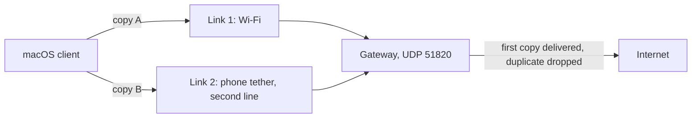

# Gemina

Gemina keeps a call or an SSH session alive when one of your internet links
drops. It sends every packet over two links at once (for example Wi-Fi and a
phone's USB tether), and a gateway you run keeps the first copy of each packet
and discards the second.

In network terms: a macOS client duplicates tunnel traffic across two
independent uplinks to one UDP gateway, which does per-session replay-window
deduplication. It is for reliability. It does not add up the speed of the two
links.

> **Status: pre-release, not validated on real dual-uplink hardware.**
> The code builds and the software tests pass. The full tunnel has never been
> run end to end on a Mac with two real uplinks. Read [What is verified](#what-is-verified)
> before you rely on it.

## Contents

* [What is verified](#what-is-verified)
* [Requirements](#requirements)
* [Build and run from source](#build-and-run-from-source)
* [How to use it](#how-to-use-it)
* [Troubleshooting](#troubleshooting)
* [Use it with your AI assistant](#use-it-with-your-ai-assistant)
* [Report results from real hardware](#report-results-from-real-hardware)
* [Install a release build](#install-a-release-build)
* [Licence](#licence)

## How it works

The client tags each packet with a session and a packet number and sends one
copy over each link. The gateway keeps a sliding window of packet numbers per
session, forwards the first copy of each, and drops the later copy. If a link
fails, its copies stop arriving and the other link's copies carry on. No
reconnect is needed.



The price is about double the data on protected traffic. The two links must be
independent (different routes to the internet). Run the gateway on a small
cloud server, not on your home line, or both copies end up on the same link.
See [`docs/self-hosting.md`](docs/self-hosting.md).

The name: Gemina is Latin for "twinned", as in the Roman *Legio Gemina*.
See [ADR-0008](docs/adr/0008-product-name-gemina.md).

## What is verified

"Tested" below means a software test in this repository passed on 17 Nov 2026:
`go test -race ./...` (exit 0, 15 packages) and the three Swift check programs
(exit 0). Nothing here was tested on real hardware by this release.

| Claim | Status | Where it is proven |
| --- | --- | --- |
| A packet sent on two paths is delivered once; later copies are dropped | Tested | `internal/dedup/replay_test.go`, `internal/dedup/window_test.go`, `internal/dedup/window_fuzz_test.go` (fuzz against a reference model) |
| The same logical packet arriving on two paths is delivered once, also under concurrency | Tested | `pkg/clientcore/session_test.go`: `TestInboundDeduplicatesSameLogicalPacketAcrossPaths`, `TestInboundConcurrentPathsDeliverEachPacketOnce` |
| Payload encryption (AES-256-GCM) rejects tampering, wrong keys and reused nonces | Tested | `pkg/clientcore/crypto_test.go`: `TestSealerRejectsTamper`, `TestSealerRejectsWrongKey`, `TestSealerDirectionPreventsNonceReuse` |
| Key agreement (X25519 + HKDF) with a pinned gateway identity; a man-in-the-middle key is refused | Tested | `pkg/clientcore/handshake_test.go`, `pkg/clientcore/handshake_auth_test.go`: `TestMITMSubstitutedKeyRejected` |
| The gateway decrypts and deduplicates across paths, and rejects forged packets and unknown sessions | Tested | `internal/gateway/dataplane_test.go`, `internal/gateway/datagateway_test.go`, `internal/gateway/handshake_test.go` |
| The gateway exit node routes packets to a TUN device and returns replies | Tested with fakes. Not tested on a live host in this release | `internal/exit/router_test.go`, `internal/gateway/datagateway_exit_test.go` |
| `geminactl probe` sends the same packet over two bound interfaces and the gateway counts one first copy and one duplicate | Tested, and run by hand on loopback (see [How to use it](#how-to-use-it)) | `cmd/geminactl/probe_test.go`, `internal/transport/pathdial_test.go` |
| Path classification (Wi-Fi, Android USB tether) and the compatibility verdict | Tested | `internal/paths`, `internal/platform/darwin`, `internal/diagnostics/compatibility_test.go` |
| Menu-bar app logic: path policy, protection status, consent, impact figures | Tested (headless check) | `swift run GeminaVPNCoreCheck` |
| Swift to Go handshake glue and the Wi-Fi path sender | Tested (headless check, with stubs for the Go core) | `swift run CoreTransportCheck`, `swift run WiFiPathSenderCheck` |
| Two independent real WANs (Wi-Fi plus an Android phone on cellular) delivered one packet each to a deployed gateway, and either could drop | Done once in June 2026 with a research program, not with this app | [`PROJECT_STATE.md`](PROJECT_STATE.md), section "Definition of Dual-Path Success" |

What is **not** verified:

* The packet tunnel (`NEPacketTunnelProvider`) has not been run on real hardware
  end to end. This check is called WS-F in [`TASKS.md`](TASKS.md).
* The tunnel in the app currently carries one path (Wi-Fi). The second uplink is
  not yet wired into the tunnel. The two-path demo is the `geminactl probe`
  command.
* The internet exit on the gateway has not been run on a live host in this
  release.
* The Android USB driver for phones that macOS does not support natively exists
  as a research spike (`research/usb-rndis-spike/`), not as part of the app.
* iPhone Personal Hotspot and Pixel USB tethering are expected to appear as
  normal network interfaces. No report from real hardware confirms this yet
  ([`COMPATIBILITY.md`](COMPATIBILITY.md)).
* No performance, battery or long-run stability numbers exist.

There are no accounts, payments or hosted gateway in this repository. You run
the gateway yourself.

## Known issues in 0.1.0

- **IPv6 can bypass the tunnel.** The macOS tunnel routes IPv4 only in this release, so IPv6 traffic may leave over the normal connection. Turn IPv6 off on the test interface, or treat 0.1.0 as IPv4-only. A fix exists and will be in the next release.
- **Gateway sessions do not expire with their entitlement.** A session stays valid until the gateway restarts. Restart the gateway to clear sessions. Fixed in the next release.

## Requirements

* A Mac running macOS 14 or later. Apple Silicon is the main target.
* Go 1.26 or later (the Go code uses only the standard library).
* For the Swift checks: Xcode 16 or later, or a Swift 6 toolchain.
* For the macOS app: Xcode and [XcodeGen](https://github.com/yonaskolb/XcodeGen).
  The packet tunnel needs a paid Apple Developer team that has the Network
  Extension entitlement. A free personal team can only build the app without the
  tunnel.
* For a real test: two independent uplinks (for example Wi-Fi and a phone's USB
  tether) and a small cloud server with one UDP port (51820) open. A server with
  a public address is needed for any real test.

## Build and run from source

```sh
git clone https://github.com/joanmarcriera/Gemina.git
cd Gemina
make bootstrap                 # prepare the Go and Swift workspace, check docs
make test                      # Go tests, Swift build, docs check
go test -race ./...            # the race-detector run that CI uses
swift run --package-path apps/macos GeminaVPNCoreCheck
swift run --package-path apps/macos WiFiPathSenderCheck
swift run --package-path apps/macos CoreTransportCheck
```

Each command should exit with code 0. Build the two programs:

```sh
mkdir -p bin
go build -o bin/gateway ./cmd/gateway
go build -o bin/geminactl ./cmd/geminactl
```

The menu-bar app, built unsigned without the tunnel (this was built and exited 0
on a Mac with Xcode 27):

```sh
cd apps/macos
xcodegen generate --spec project-dev.yml
xcodebuild -project GeminaDev.xcodeproj -scheme GeminaDev -configuration Release \
  CODE_SIGNING_ALLOWED=NO build
```

For the full app with the packet tunnel, use `xcodegen generate` (the default
`project.yml`), open the project in Xcode, choose your paid team and run. Signing
notes are in [`docs/dev/xcode-signing.md`](docs/dev/xcode-signing.md).

## How to use it

### 1. Try the dedup on one machine (no hardware needed)

This starts a gateway on loopback and sends three packets down two "paths". Both
paths use `lo0` here, so it proves the machinery, not two real links.

```sh
GEMINA_GATEWAY_ADDR=127.0.0.1:51899 GEMINA_GATEWAY_LOG_LEVEL=debug ./bin/gateway &
./bin/geminactl probe -interface lo0 -path wifi -interface2 lo0 -path2 usb \
  -to 127.0.0.1:51899 -count 3
kill %1
```

Expected output from `geminactl`:

```
sent 6 datagram(s): 3 distinct probe(s) over lo0 ("wi-fi") and lo0 ("android-usb-tether")
```

The gateway log shows `"decision":"first-copy"` for each packet's first copy and
`"decision":"duplicate"` for the second, and ends with
`"first_copies":3,"duplicates":3,"rejected":0`.

### 2. Check your Mac

```sh
./bin/geminactl preflight          # one line: a verdict and the next step
./bin/geminactl preflight -share   # redacted report you can paste into an issue
./bin/geminactl darwin-evidence    # JSON detail of the interfaces it found
```

`preflight` looks for Wi-Fi plus an Android USB tether. If your second link is an
iPhone, a second broadband line or a dongle, the verdict may say `needs-android`.
That does not mean the link is unusable. Use `ifconfig` to find its interface
name instead.

### 3. Run a gateway on a server

On a small cloud server with UDP 51820 open to any source port:

```sh
GEMINA_GATEWAY_ADDR=:51820 ./bin/gateway
```

Or build the container from
[`deploy/docker/gateway.Dockerfile`](deploy/docker/gateway.Dockerfile). All
settings are environment variables, listed in
[`docs/self-hosting.md`](docs/self-hosting.md). The default mode is `probe`.
`GEMINA_GATEWAY_MODE=data` adds the encrypted handshake and data plane, and
`GEMINA_GATEWAY_EXIT=on` adds the internet exit (Linux, needs host NAT; see
[`docs/dev/gateway-deploy.md`](docs/dev/gateway-deploy.md)).

### 4. Send probes over two real links

Find the interface names with `ifconfig` or `networksetup -listallhardwareports`
(for example `en0` for Wi-Fi and `en5` for a tethered phone). Then:

```sh
./bin/geminactl probe -interface en0 -path wifi -interface2 en5 -path2 usb \
  -to YOUR-SERVER:51820 -count 20
```

On the server, with `GEMINA_GATEWAY_LOG_LEVEL=debug`, you should see one
`first-copy` and one `duplicate` for each packet number. Unplug one link while it
runs and watch that `first-copy` lines keep coming. To compare gateways by loss
and latency, use `geminactl benchmark -to host:port`.

Then send your result with the steps in
[Report results from real hardware](#report-results-from-real-hardware).

## Troubleshooting

* **`probe` says "network is unreachable".** The interface you named has no route
  to the server, or the name is wrong. Check it with `ifconfig`.
* **The gateway sees nothing.** Open UDP 51820 in the host firewall and in the
  cloud provider's network rules. Allow any source port. The client uses a random
  high port.
* **Every packet shows `first-copy`, never `duplicate`.** Only one path reached
  the gateway. Check that both interfaces are up and have a route.
* **`preflight` says `needs-android`.** It only recognises an Android USB tether.
  See "Check your Mac" above.
* **The app builds but the tunnel does not start.** The packet tunnel needs the
  Network Extension entitlement from a paid Apple Developer team.
* **The Gatekeeper warning on a release download.** See
  [Install a release build](#install-a-release-build).
* **The tunnel's DNS.** The app sets the tunnel's DNS to Cloudflare "1.1.1.1 for
  Families" by default (`TunnelController.defaultDNSServers`). This is a product
  decision recorded in [`DECISIONS.md`](DECISIONS.md).

## Use it with your AI assistant

Copy everything in the box below into Claude Code, Codex, Cursor or a similar
coding assistant, in an empty working folder. Replace the two lines in
`MY SETUP` first.

````text
You are helping me try Gemina, a macOS tool that sends traffic over two internet
links at once. The code is at https://github.com/joanmarcriera/Gemina . It is
pre-release and has NOT been validated on real dual-uplink hardware. Software
tests only. Be honest about that in everything you write.

MY SETUP (I fill these in)
- Link 1: <for example Wi-Fi, interface name if I know it>
- Link 2: <for example iPhone USB tether, Android USB tether, second broadband>
- Gateway: <my server host:port, or "none yet, loopback only">

RULES (follow all of them)
1. Ask me before you change any network setting: routes, DNS, interfaces,
   Wi-Fi, firewall, Network Extensions, system settings. Show me the exact
   command and what it changes, and wait for a yes. Reading state is fine
   (ifconfig, netstat -rn, networksetup -listallhardwareports).
2. Never run anything as root or with sudo unless I say yes to that specific
   command in this conversation.
3. Never print, store or upload secrets, keys, tokens, public IP addresses,
   MAC addresses, phone serial numbers, my home address or my server's address.
   Redact them as <redacted> in anything you write.
4. Do not install software without telling me what and why. Do not use any
   account of mine except to open the issue in step 8, and only after I approve
   the text.

STEPS
1. Check the tools: go version (need 1.26 or later), swift --version,
   xcodebuild -version (optional, only for the app). Tell me what is missing.
2. git clone https://github.com/joanmarcriera/Gemina.git and cd into it. Read
   README.md, then PROJECT_STATE.md and COMPATIBILITY.md.
3. Run: make bootstrap, make test, go test -race ./... , and the three Swift
   checks (swift run --package-path apps/macos GeminaVPNCoreCheck,
   WiFiPathSenderCheck, CoreTransportCheck). Quote each command and its exit
   code. If something fails, stop and show me the last 20 lines.
4. Build: go build -o bin/gateway ./cmd/gateway and
   go build -o bin/geminactl ./cmd/geminactl .
5. Run the loopback demo from the README section "How to use it", part 1. Show
   me the gateway log and confirm first-copy and duplicate counts match.
6. Run ./bin/geminactl preflight -share and show me the output. Then use
   ifconfig (read only) to find the interface names for my two links. Propose
   the probe command from README part 4 using my setup. Ask me before you run it.
   If I have no gateway yet, explain how to run one on a small cloud server and
   stop there.
7. If I approve, run the two-link probe, then ask me to unplug one link while
   it runs, and watch the gateway log. Record: did every packet show one
   first-copy and one duplicate, and did first-copy lines continue after the
   unplug.
8. Write a report using the README section "Report results from real hardware"
   (macOS version, Mac model, link types, what passed, what failed, exact error
   text, redacted). Show it to me. Only if I say yes, open a GitHub issue with
   the "Hardware report" template, using the gh CLI or by giving me the text to
   paste. If a test failed, open a "bug" issue with the failing command and its
   last 20 lines of output instead.

Do not claim the product works unless step 7 showed it on my real hardware.
Say plainly what was and was not tested.
````

## Report results from real hardware

This is the most useful thing you can send. Open an issue with the
**Hardware report** template (Issues, New issue). It asks for:

* Mac model and macOS version.
* Link 1 and link 2: type (Wi-Fi, iPhone tether, Android tether and model,
  second broadband, dongle) and the interface names.
* Where the gateway ran (provider type and region are enough) and its commit.
* The `geminactl preflight -share` output.
* The exact `geminactl probe` command, with addresses removed.
* What the gateway log showed: first-copy and duplicate counts, and what
  happened when you unplugged one link.
* Anything that failed, with the exact error text.

Remove public IP addresses, MAC addresses, serial numbers and keys before you
post. `preflight -share` is already redacted. Do not post packet captures.

## Install a release build

When a version tag is pushed, GitHub builds a release from the tag. It contains:

* `geminactl-macos-universal.zip`: the command-line tool for macOS (Apple
  Silicon and Intel).
* `gemina-gateway-linux-amd64.tar.gz` and `gemina-gateway-linux-arm64.tar.gz`:
  the gateway for Linux servers.
* `SHA256SUMS`: checksums for the files above.

The macOS build is **unsigned unless the maintainer has added signing secrets**,
so macOS Gatekeeper blocks it the first time. To open it:

```sh
shasum -a 256 -c SHA256SUMS --ignore-missing   # check the download first
unzip geminactl-macos-universal.zip
xattr -d com.apple.quarantine geminactl         # clear the download flag
chmod +x geminactl
./geminactl preflight
```

Only do this if you trust the download. You can instead build from source above.
The release does not contain the menu-bar app. The packet tunnel needs a signed
build with Apple's Network Extension entitlement, which an unsigned build cannot
have.

## More documentation

* [`PROJECT_STATE.md`](PROJECT_STATE.md): current state and the next gate.
* [`TASKS.md`](TASKS.md): the task list.
* [`DECISIONS.md`](DECISIONS.md) and [`docs/adr/`](docs/adr/): decisions.
* [`docs/self-hosting.md`](docs/self-hosting.md): the gateway.
* [`docs/security/`](docs/security/): threat models. [`SECURITY.md`](SECURITY.md): how to report a vulnerability.
* [`COMPATIBILITY.md`](COMPATIBILITY.md): which setups work.
* [`CONTRIBUTING.md`](CONTRIBUTING.md) and [`AGENTS.md`](AGENTS.md): working rules.

The website folder and `docs/marketing/` are unpublished drafts.

## Licence

Gemina is released under the
[PolyForm Noncommercial License 1.0.0](LICENSE). It is free for noncommercial
use, with attribution to Riera Technologies Ltd: keep the `Required Notice:`
line in [`LICENSE`](LICENSE) and [`NOTICE`](NOTICE) when you share it.
Commercial use needs a paid licence. See [`COMMERCIAL.md`](COMMERCIAL.md) for
what counts and how to ask (through a GitHub issue).

This is source-available, not OSI open source. Source published before release
0.1.0 stays under its earlier licences (AGPL-3.0 and Apache-2.0); the texts are
in [`LICENSES/pre-0.1.0/`](LICENSES/pre-0.1.0/).
